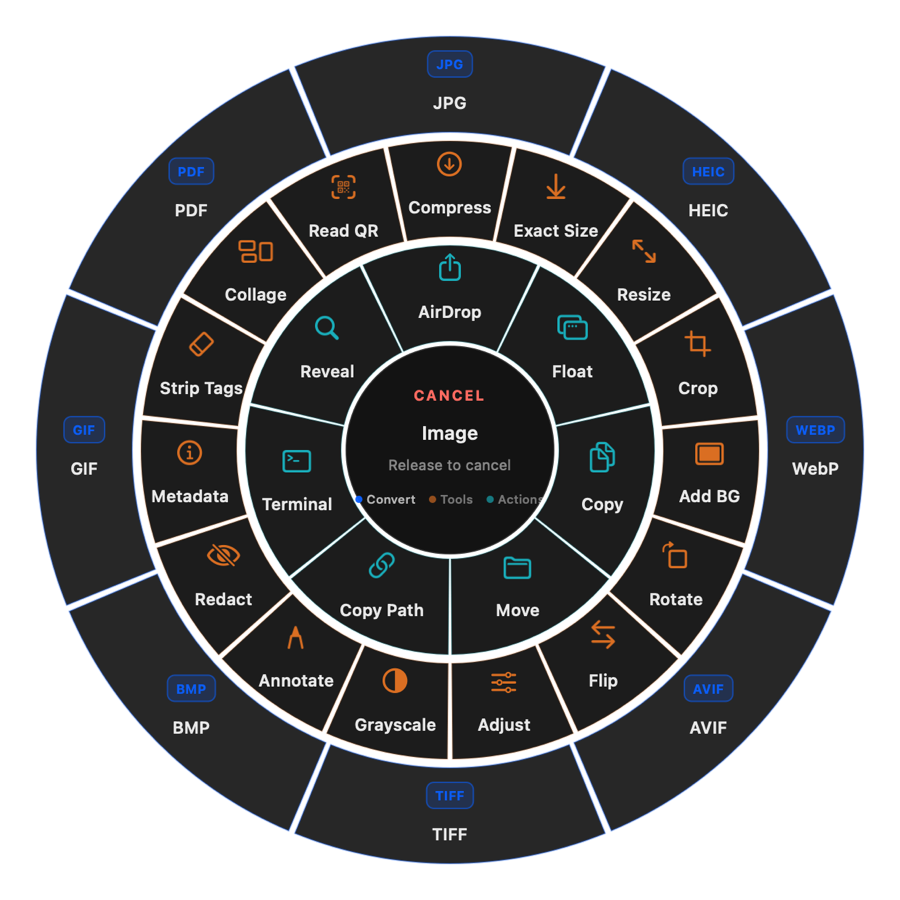

# Zest

A local-only, menu-bar file converter for macOS. Drag files in Finder, tap a modifier,
pick a target from the wheel — the converted file lands next to the original.

No windows, no uploads, no accounts. Everything runs on your Mac.



## How it works

1. Drag any file (or selection, or folder) in Finder.
2. Tap a modifier **while still dragging**:
   - <kbd>⇧ Shift</kbd> — convert to another format
   - <kbd>⌘ Command</kbd> — run a tool (crop, compress, redact, snapshot…)
   - <kbd>⌃ Control</kbd> — quick actions (copy, move, AirDrop, Terminal…)
3. The wheel appears where you tapped; keep dragging onto the ring you want and
   release.

The central hub shows the file you're holding — icon, filename, format, and size. Drop
on the hub (or off the wheel) to cancel. Results are saved beside the originals, always.

The first launch opens a short Getting Started walkthrough — reopen it any time from
Settings → About.

## The wheel

**Concentric rings** *(the default)* — every surface visible at once, floating over the
desktop with no panel behind it:

- The outer ring holds conversion formats, the middle ring the tools, the inner ring
  the actions — all of Zest's reach in one 576 pt dial.
- Tapping a modifier brightens that ring while the others stay live: the hub legend
  shows which ring maps to which key, and dropping on any ring commits that ring's
  pick, whichever modifier is currently armed.
- Drop on the hub to cancel.

**Petal fan** — the alternate style: one surface at a time as a compact flower of
graphite-glass petals, rebuilt in place when you tap a different modifier. Some people
prefer it for its bigger, upright labels; the rings dial keeps everything in one
glance.


Switch styles in Settings → General → Wheel style.

## Formats


- **Images:** JPG · PNG · WebP · HEIC · TIFF · AVIF · BMP · GIF · PDF
- **Video:** MP4 · MOV · MKV · WebM · AVI · WMV · GIF
- **Audio:** MP3 · M4A · WAV · FLAC · OGG · Opus · AIFF · WMA
- **PDF →** DOCX · PPTX · XLSX · EPUB · TXT · Markdown · RTF · images
- **Documents:** DOCX · TXT · Markdown · HTML · EPUB · RTF
- **Spreadsheets:** XLSX · ODS · CSV · TSV
- **Subtitles:** SRT · VTT · TXT
- **Archives:** ZIP · TAR · GZIP (create and extract; RAR input via `unar`)

The wheel only offers conversions your Mac can actually perform — unavailable
combinations are hidden, not greyed out.

## Tools

Crop · resize · compress / exact size · add background · rotate · flip · adjust ·
grayscale · annotate · redact · strip tags · edit metadata · collage · read QR ·
snapshots (multi-frame) · trim · split · join · speed · GIF · mute · extract audio ·
normalize · bleep · redact video · redact audio · audio → video · channels · sample
rate · PDF merge / split / reorder / rotate / extract images · archive extract.


**Actions:** AirDrop · Float (park files in a small always-on-top panel) · copy ·
move · copy path · open in Terminal · reveal in Finder.

## Settings

Five compact tabs live behind the status item:

- **General** — modifiers, wheel style (concentric rings by default, petal fan
  optional — both panel-free), feedback, collision policy (keep both / replace),
  Float behaviour, Terminal app.
- **Formats** — per-format defaults: image quality and size, audio bitrate and depth,
  video quality and max height, GIF frame rate and width, PDF and EPUB layout.
- **Compatibility** — a live input → output matrix generated from what your machine
  can really do.
- **Folders** — output behaviour and useful locations.
- **About** — version, engine status, onboarding.

Settings persist in `com.zest.app` and apply to every drag instantly.

## Requirements

- macOS 13 Ventura or newer, Apple Silicon or Intel
- Optional, for media formats: Homebrew `ffmpeg` (audio/video conversion and tools)
  and `cwebp` (WebP output). Zest detects them at launch and hides what's missing.

## Installation

**Easiest** — grab the disk image from the [releases page](https://github.com/shin0biX/zest/releases/latest),
open it, and drag Zest.app to Applications:

- [Zest.dmg — latest release](https://github.com/shin0biX/zest/releases/latest/download/Zest.dmg)
- It's a personal build without an Apple Developer certificate, so the first launch
  needs a right-click → **Open** → **Open** (once), or
  `xattr -cr /Applications/Zest.app` in Terminal.
- Optional, for video/audio: `brew install ffmpeg`.

**From source** — you'll need the Xcode command-line tools
(`xcode-select --install`):

```sh
git clone https://github.com/shin0biX/zest.git
cd zest/Zest
./build.sh          # release build, app icon, ad-hoc signature
open Zest.app       # launches in the menu bar — no Dock icon
```

`build.sh` compiles the release binary, applies the app icon, and ad-hoc signs the
bundle — no Gatekeeper dance, because the app was built on your machine. Zest then
lives in the menu bar and can be enabled at login from Settings → General.

Prefer a quick debug build instead?

```sh
cd zest/Zest
swift build
.build/debug/Zest selftest   # 93 engine checks
.build/debug/Zest uitest     # 29 UI checks
```

## Command line

The same binary works headless — useful for scripting or CI:

```sh
Zest formats sample.png                      # what can this file become?
Zest convert sample.png --to pdf             # images → PDF accepts several files
Zest tool compress sample.png --params percent=50
Zest tool redactVideo clip.mp4 --params x=40 y=30 w=160 h=90 start=0 end=0.6 mode=box
Zest wheel /tmp/wheel.png --kind image       # render the wheel (any style/kind)
```

## Privacy

Zest never opens a network connection for its work. Conversion runs through local
system frameworks (ImageIO, PDFKit, CoreText, Vision) and, when installed, your
Homebrew `ffmpeg`. Files stay on your disk; nothing is uploaded, logged remotely, or
telemetered. Output always lands next to the source file, so you always know where
your data is.

## Development

Swift 5.9 · AppKit, programmatic UI · zero third-party packages.

```sh
cd Zest
swift build
.build/debug/Zest selftest        # engine suite (structural verification)
.build/debug/Zest uitest          # in-process UI suite, no permissions needed
./build.sh                        # release bundle
./Harness/run.sh all              # 12 end-to-end Finder-drag scenarios (needs Accessibility;
```

The [external harness](Zest/Harness/) drives real Finder drags through the shipped app
and verifies outputs structurally — every commit in this repo passed it (it enables
the app's drag-trace logging for its run and restores quiet mode after).

## License

Personal, private build — no license granted for redistribution.
